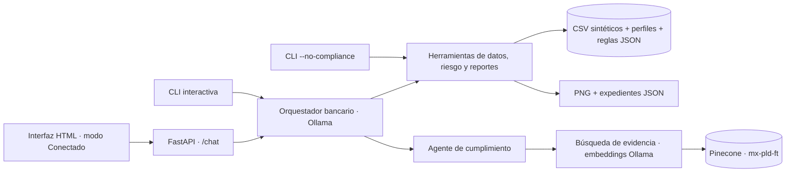

# BankGuard AI — Data Steward bancario

Beta académica del **Grupo 04** para explorar datos transaccionales ficticios, detectar patrones que requieren revisión y consultar evidencia documental de prevención de lavado de dinero y financiamiento al terrorismo (PLD/FT).

**Objetivo del Data Steward:** ayudar a que el análisis sea comprensible, reproducible y trazable: validar datos y perfiles, explicar las reglas del score, conservar la procedencia de las fuentes y distinguir entre un hallazgo analítico y una conclusión de cumplimiento que requiere revisión humana.

## Equipo

| Integrante | Equipo |
| --- | --- |
| David Isaí Díaz Avilés | Grupo 04 |
| Ian Paulo García González | Grupo 04 |
| Luis Enrique Hernández Torres | Grupo 04 |
| Pablo Alberto Ramos Roldán | Grupo 04 |

**Repositorio Git del equipo:** [luis1112enrique/bankguard-ai-grupo-04](https://github.com/luis1112enrique/bankguard-ai-grupo-04). El repositorio original del curso es la base del trabajo; esta liga identifica la entrega del Grupo 04.

## Qué se puede demostrar

- Análisis local reproducible de **202 operaciones sintéticas** de seis clientes (`C001`–`C006`).
- Indicadores calculados con Python, pandas y NumPy: montos, frecuencia, concentración, inconsistencias contra el perfil y operaciones atípicas.
- Score simulado con cuatro factores y resultado `no_concluyente` cuando falta historial suficiente.
- Dos agentes LangChain independientes: un orquestador bancario y un especialista de cumplimiento que recupera evidencia mediante Ollama y Pinecone.
- Gráficas PNG y expedientes JSON para revisión humana.
- Interfaz HTML con modo **Demostración** (respuestas predefinidas) y modo **Conectado** (API local real).

Los datos y las reglas de riesgo son ficticios. El score no representa un umbral oficial ni determina que una operación sea ilícita.

## Arquitectura general



Los cálculos proceden del motor determinista, no de aritmética del LLM. La consulta regulatoria usa el namespace `mx-pld-ft` y el filtro `corpus_id=mx-pld-ft`. Durante las consultas, BankGuard no crea índices ni escribe vectores. La ingestión se realiza por separado. Consulta el [diagrama y las responsabilidades de cada componente](docs/ARCHITECTURE.md).

## Instalación y dependencias

Se requiere **Python 3.12 o posterior** y [uv](https://docs.astral.sh/uv/getting-started/installation/). Clona el repositorio del equipo e instala el entorno bloqueado:

```bash
git clone https://github.com/luis1112enrique/bankguard-ai-grupo-04.git
cd bankguard-ai-grupo-04
uv sync --locked --dev
```

[pyproject.toml](pyproject.toml) declara las dependencias y [uv.lock](uv.lock) fija sus versiones. Las principales para BankGuard son LangChain/LangGraph, `langchain-ollama`, `langchain-pinecone`, Pydantic, pandas, NumPy, Matplotlib, FastAPI, Uvicorn y pytest para pruebas. El manifiesto conserva también dependencias de los ejemplos del curso.

El análisis determinista y el modo visual Demostración pueden ejecutarse sin claves de API ni servicios de IA. Para conversar con los agentes se necesita Ollama; la consulta documental necesita además Pinecone y un corpus previamente indexado.

## Cómo ejecutar la beta

### 1. Análisis local sin servicios de IA

```bash
uv run python agents/10_bankguard_agent.py \
  --client C003 \
  --start 2026-10-01 \
  --end 2026-10-31 \
  --no-compliance
```

Devuelve JSON con métricas y score; genera gráficas en `outputs/charts/` y un expediente en `outputs/alerts/` cuando corresponde. Se pueden añadir `--no-charts` y `--no-alert`. Este flujo no invoca Ollama ni Pinecone. El caso `C006` permite mostrar la falta de historial sin presentarla como riesgo bajo.

### 2. Interfaz visual sin backend

```bash
uv run python -m http.server 8765 --bind 127.0.0.1
```

Abre [http://127.0.0.1:8765](http://127.0.0.1:8765). El modo **Demostración** funciona con respuestas predefinidas sobre Data Stewardship, modelos dimensionales y relaciones cliente/cuenta/transacción. Sirve para enseñar el diseño de la conversación; no ejecuta análisis transaccional ni recuperación documental.

### 3. Conversación y frontend conectado

Instala e inicia [Ollama](https://ollama.com/), y descarga los modelos configurados:

```bash
ollama pull qwen3.5:4b
ollama pull bge-large
```

Si el servicio no está activo, ejecuta `ollama serve` en otra terminal. Para RAG, configura un archivo `.env` local en la raíz a partir de [.env.example](.env.example). Si ya tienes `.env`, agrega solo las variables faltantes; no lo reemplaces. La plantilla de `agents/bankguard/` se conserva por compatibilidad. Los valores relevantes son:

```dotenv
PINECONE_API_KEY=TU_CLAVE_LOCAL
INDEX_NAME=NOMBRE_DE_TU_INDICE_EXISTENTE
PINECONE_NAMESPACE=mx-pld-ft
RAG_CORPUS_ID=mx-pld-ft
OLLAMA_CHAT_MODEL=qwen3.5:4b
EMBEDDING_MODEL=bge-large
BANKGUARD_TRACING=false
LANGSMITH_TRACING=false
LANGCHAIN_TRACING_V2=false
DELETE_STALE_VECTORS=false
```

El modelo de embeddings y la dimensión del índice deben coincidir con los usados en la ingestión. La plantilla no contiene credenciales reales. No subas tu `.env` ni claves al repositorio.

Inicia la API en una terminal:

```bash
uv run uvicorn agents.bankguard.api:app --host 127.0.0.1 --port 8000
```

En otra terminal, sirve el frontend:

```bash
uv run python -m http.server 8765 --bind 127.0.0.1
```

Abre [http://127.0.0.1:8765](http://127.0.0.1:8765), selecciona **Conectado** y escribe una pregunta bancaria de los ejemplos siguientes. La interfaz envía `POST /chat` a `http://127.0.0.1:8000`; [http://127.0.0.1:8000/health](http://127.0.0.1:8000/health) comprueba que la API responde, pero no valida la disponibilidad de Ollama ni de Pinecone.

También puedes usar la conversación de terminal:

```bash
uv run python agents/10_bankguard_agent.py
```

Escribe `salir` para terminar. Los errores del servicio documental se reportan como tales; no deben interpretarse como evidencia normativa disponible.

### 4. Carga inicial del RAG en un entorno nuevo (opcional)

Solo se necesita si todavía no tienes el corpus indexado. Prepara Ollama y el modelo `bge-large`, configura tu clave local de Pinecone y un `INDEX_NAME` propio en `.env`, y conserva `PINECONE_NAMESPACE=mx-pld-ft`, `RAG_CORPUS_ID=mx-pld-ft` y `DELETE_STALE_VECTORS=false` como en la plantilla. Después ejecuta:

```bash
uv run python agents/9_agentic_rag.py
```

El script lee `agents/rag_documents/`, calcula embeddings y escribe los fragmentos en tu índice; puede crearlo si no existe. La opción de la plantilla evita eliminar fragmentos previos. El servicio de Pinecone puede consumir cuota o generar cargos según tu plan. Esta carga se realiza explícitamente y no se ejecuta al iniciar la beta. El análisis sin IA y el modo visual Demostración funcionan sin hacerla.

## Archivos de metadata y governance

| Archivo | Uso en la beta |
| --- | --- |
| [bank_transactions.csv](agents/data/bank_transactions.csv) | Operaciones ficticias: identificadores, cliente, fecha, monto, moneda, tipo, canal y ubicación. |
| [client_profiles.csv](agents/data/client_profiles.csv) | Perfil esperado: antigüedad, montos habituales, frecuencia, moneda y categorías permitidas. |
| [risk_config.json](agents/bankguard/risk_config.json) | Pesos del score, umbrales simulados, mínimos de historial y reglas de atipicidad. |
| [LIC.txt](agents/rag_documents/LIC.txt) | Texto local de la Ley de Instituciones de Crédito; el archivo declara reforma del 14 de noviembre de 2025. |
| [Disposiciones_Articulo_115_LIC.txt](agents/rag_documents/Disposiciones_Articulo_115_LIC.txt) | Texto local de las disposiciones del artículo 115; contiene una versión histórica con referencias de 2009. |
| [Guía CNBV 2019](agents/rag_documents/CNBV_Guia_Metodologia_Evaluacion_Riesgos_PLD_FT_2019.txt) | Documento metodológico del corpus para evaluación de riesgos PLD/FT. |
| [Guía GAFI 2014](agents/rag_documents/GAFI_Enfoque_Basado_en_Riesgo_Sector_Bancario_2014.txt) | Orientación del corpus sobre enfoque basado en riesgo en el sector bancario. |
| [Script de ingestión](agents/9_agentic_rag.py) | Asigna metadatos de procedencia: corpus, fuente, título, autoridad, tipo, página, artículo/disposición, cita y hash cuando están disponibles. |

El [inventario de metadata y gobierno](docs/METADATA_GOVERNANCE.md) explica estos controles. No hay un catálogo empresarial completo ni un glosario de gobierno de datos implementados: el alcance actual son perfiles, reglas y metadatos documentales. Los archivos locales documentan qué corpus se espera; un índice de Pinecone de otro entorno debe prepararse por separado antes de consultar el RAG.

## Ejemplos de preguntas

En el modo conectado o la CLI interactiva:

- «Lista los clientes ficticios y la fecha de referencia del dataset».
- «Analiza las operaciones del cliente C003 del 1 al 31 de octubre de 2026 y calcula sus indicadores».
- «Genera una gráfica de los movimientos de C003 durante octubre de 2026».
- «Analiza C006 durante octubre de 2026 y explica si existe historial suficiente para calcular el score».
- «¿Qué fuentes del corpus describen el enfoque basado en riesgo para PLD/FT en instituciones bancarias?».
- «Analiza a C003 durante octubre de 2026 y consulta qué criterios documentados de PLD/FT son relevantes para revisarlo».

Las dos últimas preguntas necesitan RAG configurado y evidencia pertinente. Las preguntas de la interfaz sobre Data Stewardship y modelado usan respuestas predefinidas solo cuando está seleccionado el modo Demostración.

## Reproducir la demostración y probar

Los CSV están incluidos; no es necesario regenerarlos. Para obtener otra copia reproducible dentro del repositorio, sin sobrescribir los originales:

```bash
uv run python -m agents.bankguard.data_generator --output-dir outputs/demo-data
```

El generador usa la semilla `20261020`. El dataset abarca julio–octubre de 2026 y su fecha de referencia es **2026-10-31**, independientemente de la fecha del equipo. «Últimos N días» se interpreta contra esa referencia sintética.

Ejecuta las pruebas de BankGuard sin integración externa:

```bash
LANGSMITH_TRACING=false LANGCHAIN_TRACING_V2=false \
uv run pytest tests/bankguard -q -m "not integration"
```

La prueba de integración es optativa y requiere Ollama, credenciales e índice preparados:

```bash
RUN_BANKGUARD_INTEGRATION=1 uv run pytest tests/bankguard -q -m integration
```

El [guion de demostración](docs/DEMO.md) detalla los comandos, los casos y los artefactos a mostrar. No se incluye una presentación de diapositivas en esta versión; el guion es el material de apoyo para la demo.

## Estructura de la entrega

```text
README.md                          # presentación e instrucciones del equipo
.env.example                       # plantilla canónica, sin credenciales
index.html                         # frontend: Demostración / Conectado
pyproject.toml / uv.lock            # dependencias y versiones
agents/
  10_bankguard_agent.py             # CLI
  9_agentic_rag.py                  # ingestión separada del corpus
  bankguard/                       # API, agentes, validación, riesgo y reportes
    .env.example                   # plantilla de compatibilidad
    risk_config.json               # reglas simuladas
  data/
    bank_transactions.csv          # operaciones ficticias
    client_profiles.csv            # perfiles ficticios
  rag_documents/                   # corpus local esperado
tests/bankguard/                   # pruebas e integración optativa
docs/
  ARCHITECTURE.md                   # diagrama y responsabilidades
  DEMO.md                          # guion reproducible
  METADATA_GOVERNANCE.md            # inventario y controles
  README_CURSO.md                   # README original del curso
outputs/                           # artefactos locales, ignorados por Git
```

El repositorio conserva ejemplos de `agents/`, `mcp/` y `cloud_run_mcp/` provenientes del curso. Sus instrucciones originales están en [README_CURSO.md](docs/README_CURSO.md). El historial previo corresponde a ese material; la evidencia de trabajo del equipo debe identificarse mediante los commits reales que incorporan BankGuard y sus mejoras, sin atribuir al equipo los commits del curso.

## Limitaciones actuales

- Es una beta local con datos ficticios. No se conecta con un banco ni produce reportes regulatorios oficiales.
- Los pesos `40/25/20/15` y los umbrales `40/70` del score son reglas del prototipo. La falta de datos produce `no_concluyente`.
- Los archivos del corpus no acreditan vigencia jurídica actual ni cobertura completa. Las disposiciones históricas y las guías requieren validación humana antes de una aplicación real.
- La respuesta libre del LLM puede contener errores. Las métricas verificables se obtienen del flujo determinista; una cita prueba procedencia, no suficiencia jurídica.
- RAG depende de Ollama, embeddings compatibles y Pinecone previamente poblado. La latencia depende del equipo y de los servicios.
- La interfaz limita cada pregunta a 500 caracteres, conserva hasta cuatro mensajes de contexto, solicita hasta 300 tokens de salida y espera hasta 120 segundos. No muestra un tablero de gráficas: los artefactos generados se revisan en disco.
- La beta no implementa autenticación, autorización, cifrado de los expedientes, retención ni auditoría inmutable. Debe ejecutarse en el entorno local de demostración.
- Cada cliente debe usar una sola moneda; no se implementa conversión de divisas.

## Git y secretos

La entrega debe apuntar al commit que contiene la versión demostrada. Conserva el historial real y registra cambios adicionales con mensajes concretos; no se reconstruye un historial ficticio de contribuciones.

`.gitignore` excluye `.env`, `.history/`, `.venv/` y `outputs/`. Antes de confirmar un cambio revisa `git status` y `git diff --cached`. La plantilla [.env.example](.env.example) sí se incluye porque contiene únicamente nombres de variables y valores de ejemplo; mantiene deshabilitadas las trazas externas y la eliminación de vectores previos en la ingestión.
