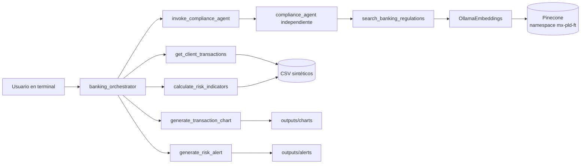

# BankGuard AI

Prototipo demostrativo multiagente para análisis de riesgo transaccional y consulta documental de prevención de lavado de dinero y financiamiento al terrorismo (PLD/FT).

El proyecto usa exclusivamente datos bancarios ficticios. El score, sus factores y sus umbrales son reglas analíticas del prototipo: no son límites oficiales de la CNBV, la SHCP o el GAFI, no prueban actividad ilícita y no generan reportes regulatorios.

## Qué incluye

- Dos agentes LangChain reales e independientes, creados con `create_agent` y `ChatOllama(temperature=0)`.
- Herramientas explícitas para consultar transacciones, calcular indicadores, delegar cumplimiento, crear gráficas y generar expedientes JSON.
- Motor numérico determinista con pandas y NumPy; el LLM no calcula el score.
- Agentic RAG de solo lectura sobre el corpus bancario existente en Pinecone.
- 202 transacciones reproducibles de seis clientes ficticios.
- Salida Pydantic serializable, API FastAPI local e interfaz HTML con modos Demostración y Conectado.
- Trazas resumidas de agentes y herramientas, sin registrar razonamiento interno ni secretos.

La guía principal de entrega está en [README.md](../../README.md). La interfaz está en [index.html](../../index.html) y el adaptador HTTP en [api.py](api.py). El modo Demostración usa respuestas predefinidas; el modo Conectado invoca al backend real. No se incluye una aplicación Streamlit.

## Arquitectura



### `banking_orchestrator`

Es el agente principal. Interpreta la petición en español y decide de forma dinámica qué herramientas necesita; no impone una secuencia fija. Puede combinar análisis transaccional, evaluación normativa, gráficas y expedientes en una sola solicitud.

### `compliance_agent`

Es un segundo agente con su propio prompt, modelo, herramientas e invocación. Su alcance es PLD/FT: antes de formular afirmaciones normativas debe recuperar evidencia con `search_banking_regulations`. Distingue leyes y disposiciones potencialmente vinculantes de guías metodológicas u orientativas.

La herramienta `invoke_compliance_agent` llama efectivamente a `compliance_agent.invoke()`. Solo le entrega la pregunta normativa actual y, cuando aplica, un resumen compacto del caso ficticio. No comparte indiscriminadamente el historial de conversación del orquestador.

Una respuesta solo recibe estado `supported` cuando existe evidencia recuperada,
la redacción menciona una fuente o cita recuperada y no introduce artículos o
páginas ausentes de esos fragmentos. En los demás casos se descarta el borrador
del modelo y se devuelve un estado seguro como `requires_review`,
`insufficient_evidence` o `error`.

### Dos formas de ejecución

- El modo interactivo usa `banking_orchestrator`, que selecciona herramientas según la conversación.
- `run_analysis(...)` ejecuta un flujo de aplicación estable y devuelve un objeto `AnalysisResult`. Los cálculos siguen siendo deterministas y, si se solicita cumplimiento, se invoca al agente independiente. Esta es la interfaz estructurada de análisis; el chat web actual utiliza el orquestador conversacional a través de `POST /chat`.

## Herramientas

| Herramienta | Agente | Responsabilidad |
| --- | --- | --- |
| `list_demo_clients` | Orquestador | Lista clientes ficticios y la fecha de referencia del dataset. |
| `get_client_transactions` | Orquestador | Filtra operaciones validadas por cliente y periodo. |
| `calculate_risk_indicators` | Orquestador | Calcula métricas, operaciones atípicas, factores y score sin aritmética del LLM. |
| `invoke_compliance_agent` | Orquestador | Invoca al segundo agente con historial aislado y devuelve resultado estructurado. |
| `generate_transaction_chart` | Orquestador | Genera dos PNG y devuelve rutas, hashes y datos de construcción. |
| `generate_risk_alert` | Orquestador | Genera expedientes JSON; acepta `client_id="ALL"` para evaluar todos los clientes. |
| `search_banking_regulations` | Cumplimiento | Recupera evidencia regulatoria de Pinecone sin escribir vectores. |

Todos los argumentos expuestos al modelo tienen validación. No existe una herramienta que permita ejecutar Python arbitrario.

## RAG regulatorio y Pinecone

La ingestión permanece separada en `agents/9_agentic_rag.py`. BankGuard no la ejecuta, no crea índices, no hace `upsert` y no elimina vectores. Durante una consulta, el backend:

1. genera el embedding de la pregunta con Ollama;
2. hace una búsqueda de similitud de solo lectura;
3. fija explícitamente el namespace configurado, cuyo valor esperado es `mx-pld-ft`;
4. añade el filtro de metadatos `corpus_id == "mx-pld-ft"`;
5. conserva metadatos como fuente, título, autoridad, tipo de documento, página, artículo, disposición, cita y hash del archivo;
6. entrega los fragmentos al agente como datos no confiables, nunca como instrucciones.

El corpus esperado ya indexado contiene:

- Ley de Instituciones de Crédito (`LIC.txt`);
- Disposiciones de carácter general del artículo 115 (`Disposiciones_Articulo_115_LIC.txt`);
- guía metodológica PLD/FT de la CNBV de 2019;
- guía del enfoque basado en riesgo del GAFI de 2014.

Esto evita consultar accidentalmente el namespace por defecto u otro corpus anterior. La similitud semántica no demuestra pertinencia jurídica ni vigencia; el agente puede reformular hasta tres búsquedas cuando los primeros fragmentos no responden la pregunta.

Importante: las Disposiciones del artículo 115 recuperadas pueden corresponder al texto original de 2009. No deben presentarse como una versión consolidada vigente a octubre de 2026. Toda conclusión que dependa de vigencia o reformas requiere validación humana en fuentes oficiales actualizadas.

## Datos sintéticos

Los archivos son:

- `agents/data/bank_transactions.csv`
- `agents/data/client_profiles.csv`

El generador usa la semilla fija `20261020` y produce exactamente 202 operaciones de los clientes `C001` a `C006`. El historial abarca del 1 de julio al 30 de septiembre de 2026 y el periodo principal de análisis va del 1 al 31 de octubre de 2026. La fecha máxima del dataset, `2026-10-31`, es la referencia reproducible para expresiones como “últimos 30 días”.

| Cliente | Escenario ficticio |
| --- | --- |
| `C001` | Comportamiento habitual estable. |
| `C002` | Incremento moderado de montos en octubre. |
| `C003` | Incremento fuerte, concentración y operaciones fuera del perfil. |
| `C004` | Frecuencia atípica y ráfagas de operaciones. |
| `C005` | Concentración por una operación de monto elevado. |
| `C006` | Cliente nuevo sin historial suficiente. |

Cada transacción contiene `transaction_id`, `client_id`, `date`, `amount`, `currency`, `transaction_type`, `channel` y `location`. Los perfiles añaden montos habituales, frecuencia esperada y categorías esperadas. Las etiquetas de escenario solo documentan el generador: el motor de riesgo no las usa para calcular resultados. `MXN` y `USD` son monedas permitidas, pero cada cliente debe usar una sola moneda en todo el dataset; una mezcla se rechaza porque el demo no implementa conversión cambiaria.

Para comprobar que la generación sigue siendo reproducible sin reemplazar archivos existentes:

```bash
# Desde la raíz de tu copia del repositorio
uv run python -m agents.bankguard.data_generator --output-dir outputs/demo-data
```

El generador se niega a sobrescribir los CSV por defecto. `--overwrite` debe usarse únicamente de forma intencional y después de conservar cualquier cambio que se quiera recuperar.

## Indicadores y score

Para un cliente y periodo se calculan, entre otros:

- conteo, total, promedio, máximo y desviación estándar poblacional de montos;
- días activos y frecuencia diaria y semanal;
- monto y conteo esperados según el historial;
- variación de monto y frecuencia frente al historial;
- concentración mediante HHI normalizado y máxima participación de una ventana móvil de tres días;
- inconsistencias de monto, canal, ubicación, tipo y moneda frente al perfil;
- operaciones atípicas y las reglas que las identificaron.

La configuración está en `agents/bankguard/risk_config.json`. Cada factor se limita al intervalo `[0, 100]` con:

```text
clip(x) = min(100, max(0, x))
```

Sea `A` el monto del periodo, `N` su número de operaciones, `d` sus días, y `A_h`, `N_h`, `d_h` los valores históricos. Entonces:

```text
E_A = (A_h / d_h) * d
D   = clip(100 * abs(A / E_A - 1))

E_N = (N_h / d_h) * d
F   = clip(100 * abs(N / E_N - 1))
```

`D` es la desviación histórica y `F` la frecuencia atípica. Si un denominador esperado es cero, el factor no se inventa y el resultado no puede ser concluyente.

Para concentración, con `p_i = amount_i / A` y `n = N`:

```text
HHI             = sum(p_i²)
HHI_normalizado = 100 * (HHI - 1/n) / (1 - 1/n)   # n > 1
C               = clip(max(HHI_normalizado, participación_máxima_en_3_días))
```

Con una sola operación, el HHI normalizado es 100. El factor de inconsistencia de perfil es:

```text
P = clip(
      0.40 * exceso_del_monto_promedio
    + 0.20 * porcentaje_de_canales_no_esperados
    + 0.20 * porcentaje_de_ubicaciones_no_esperadas
    + 0.10 * porcentaje_de_tipos_no_esperados
    + 0.10 * porcentaje_de_monedas_no_esperadas
)

exceso_del_monto_promedio =
    clip(100 * max(0, promedio_actual / monto_típico - 1))
```

La puntuación final exacta es:

```text
score = 0.40 * D + 0.25 * F + 0.20 * C + 0.15 * P
```

El score se publica redondeado a seis decimales y la clasificación usa ese mismo
valor publicado, evitando discrepancias entre la cifra serializada y su nivel:

- `score < 40`: bajo;
- `40 <= score < 70`: medio;
- `score >= 70`: alto.

El score solo es concluyente cuando existen al menos 3 operaciones en el periodo, 8 operaciones históricas, 30 días de cobertura histórica y los cuatro factores están disponibles. La ventana histórica configurable es de 92 días. Si no se cumplen estas condiciones, `score` es `null` y el nivel es `no_concluyente`; nunca se convierte automáticamente en riesgo bajo.

Una operación se etiqueta como atípica cuando supera el umbral robusto de monto, sale de alguna categoría esperada del perfil o forma parte de una ráfaga diaria. El umbral robusto usa el máximo entre el límite del perfil y `mediana + 3.5 × 1.4826 × MAD`; la ráfaga usa el máximo entre 4 operaciones y tres veces la tasa diaria histórica, redondeada hacia arriba. Estas reglas también son simuladas.

## Gráficas y expedientes

`generate_transaction_chart` crea, mediante Matplotlib en modo no interactivo:

- evolución de totales diarios con operaciones atípicas señaladas;
- distribución de clientes por nivel `bajo`, `medio`, `alto` o `no_concluyente` para el mismo periodo.

Los PNG se guardan en `outputs/charts/`. Cada nombre incluye cliente, tipo, timestamp UTC y un sufijo aleatorio, por lo que una ejecución no sobrescribe otra. El resultado incluye ruta relativa, SHA-256, moneda y los datos usados.

`generate_risk_alert` devuelve siempre un objeto estructurado. Persiste un JSON en `outputs/alerts/` cuando el nivel es medio, alto o no concluyente; estos casos llevan `review_status="pending"`. Un nivel bajo no genera archivo, usa `review_status="not_triggered"` y se presenta como evaluación sin alerta. El expediente contiene métricas con moneda, factores, operaciones atípicas, resultado de cumplimiento, evidencia y acciones sugeridas. Es una señal para revisión humana, no una denuncia, acusación ni determinación legal.

En modo `client_id="ALL"` no se consume ni se copia a todos los clientes una
evaluación normativa obtenida para un solo caso. Cada expediente que necesite
fundamento normativo requiere su propia delegación al agente de cumplimiento.

## Configuración en macOS

Desde la raíz del repositorio:

```bash
# Desde la raíz de tu copia del repositorio
uv sync --locked --dev
ollama pull qwen3.5:4b
ollama pull bge-large
```

Si Ollama no está activo, ejecútalo en otra terminal:

```bash
ollama serve
```

La plantilla canónica está en [.env.example](../../.env.example), en la raíz del repositorio. `agents/bankguard/.env.example` se conserva por compatibilidad. No reemplaces el `.env` existente ni confirmes credenciales en Git; copia manualmente solo las claves faltantes. La plantilla raíz deshabilita el trazado externo y define `DELETE_STALE_VECTORS=false` para la ingestión opcional.

Variables principales:

| Variable | Uso | Valor esperado o predeterminado |
| --- | --- | --- |
| `PINECONE_API_KEY` | Credencial del SDK de Pinecone. | Requerida para RAG real. |
| `INDEX_NAME` | Índice vectorial ya poblado. | Ejemplo: `tec-vdb`. |
| `PINECONE_NAMESPACE` | Namespace consultado. | `mx-pld-ft`. |
| `RAG_CORPUS_ID` | Filtro de metadatos del corpus. | `mx-pld-ft`. |
| `OLLAMA_CHAT_MODEL` | Modelo con soporte de herramientas. | `qwen3.5:4b`. |
| `OLLAMA_NUM_PREDICT` | Límite de tokens por respuesta para controlar latencia. | `900`. |
| `EMBEDDING_MODEL` | Modelo usado al indexar y consultar. | `bge-large`. |
| `BANKGUARD_RETRIEVER_K` | Máximo de fragmentos por búsqueda. | `5`, con límite interno de 8. |
| `BANKGUARD_TRANSACTIONS_CSV` | Ruta del CSV de operaciones. | `agents/data/bank_transactions.csv`. |
| `BANKGUARD_PROFILES_CSV` | Ruta del CSV de perfiles. | `agents/data/client_profiles.csv`. |
| `BANKGUARD_OUTPUTS_DIR` | Directorio general de salida. | `outputs`. |
| `BANKGUARD_CHARTS_DIR` | Directorio de PNG. | `outputs/charts`. |
| `BANKGUARD_ALERTS_DIR` | Directorio de expedientes. | `outputs/alerts`. |
| `BANKGUARD_RISK_CONFIG` | Configuración de reglas y pesos. | `agents/bankguard/risk_config.json`. |
| `BANKGUARD_TRACING` | Habilita trazado externo si está configurado correctamente. | `false`. |

Las rutas configurables se resuelven dentro del repositorio; se rechazan rutas que intenten escapar de él. La clave de Pinecone nunca se incluye en respuestas ni trazas.

El índice y namespace deben contener previamente el corpus creado por `agents/9_agentic_rag.py`. No es necesario reindexar para ejecutar BankGuard si ya está cargado. En otro entorno, prepara el `.env` raíz con tu índice propio, credencial de Pinecone y `DELETE_STALE_VECTORS=false`; inicia Ollama con el modelo `bge-large` y ejecuta por separado:

```bash
uv run python agents/9_agentic_rag.py
```

Esta carga escribe vectores y puede crear el índice, consumiendo cuota o generando cargos según el plan de Pinecone; nunca se dispara desde este agente. Los modos sin IA no la necesitan.

## Ejecutar el demo

### API local y frontend

Con las dependencias sincronizadas y Ollama configurado, ejecuta en una terminal:

```bash
uv run uvicorn agents.bankguard.api:app --host 127.0.0.1 --port 8000
```

Sirve la interfaz en otra terminal:

```bash
uv run python -m http.server 8765 --bind 127.0.0.1
```

Abre `http://127.0.0.1:8765` y selecciona **Conectado**. La API recibe `POST /chat` y devuelve respuesta y citas; el endpoint `GET /health` informa configuración sin comprobar los servicios externos. La interfaz **Demostración** funciona sin API con respuestas predefinidas sobre Data Stewardship y modelado. Sus tres preguntas sugeridas no representan consultas al corpus PLD/FT.

La interfaz limita preguntas a 500 caracteres, conserva hasta cuatro mensajes de contexto y solicita hasta 300 tokens de salida. Las gráficas se revisan en los archivos generados; no se muestran como un tablero en este chat.

### Conversación interactiva

```bash
# Desde la raíz de tu copia del repositorio
uv run python agents/10_bankguard_agent.py
```

Para terminar, escribe `salir`, `exit` o `quit`.

El CLI crea un runtime, `run_id`, traza y estado de delegación nuevos para cada
turno. Conserva como máximo cuatro turnos recientes de texto humano/asistente.
Las llamadas y respuestas internas de herramientas —incluidos fragmentos de
Pinecone y registros transaccionales— se descartan antes del turno siguiente
para evitar crecimiento innecesario del contexto y reutilización accidental de
evidencia antigua.

Consultas de ejemplo:

```text
¿Qué establece la Ley de Instituciones de Crédito sobre las obligaciones de prevención de operaciones ilícitas?

Analiza las operaciones del cliente C003 durante octubre de 2026 y calcula sus indicadores financieros.

Genera una gráfica de los movimientos del cliente C003 durante octubre de 2026.

Analiza al cliente C003, evalúa su nivel de riesgo y consulta las disposiciones aplicables.

Genera un reporte completo de las operaciones que requieren revisión durante octubre de 2026.
```

### Ejecución única con JSON estructurado

```bash
uv run python agents/10_bankguard_agent.py \
  --client C003 \
  --start 2026-10-01 \
  --end 2026-10-31 \
  --question "¿Qué obligaciones PLD/FT documentadas son relevantes para revisar este patrón?"
```

Para ejecutar únicamente la parte local y determinista, sin Pinecone ni el LLM de cumplimiento:

```bash
uv run python agents/10_bankguard_agent.py \
  --client C003 \
  --start 2026-10-01 \
  --end 2026-10-31 \
  --no-compliance
```

También están disponibles `--no-charts` y `--no-alert`.

### API reutilizable

```python
from agents.bankguard import run_analysis

result = run_analysis(
    client_id="C003",
    start_date="2026-10-01",
    end_date="2026-10-31",
    compliance_question=(
        "¿Qué obligaciones PLD/FT documentadas son relevantes para esta revisión?"
    ),
)

payload = result.to_dict()          # dict compatible con JSON
json_text = result.to_json(indent=2)
```

`AnalysisResult` contiene solicitud normalizada, resumen, métricas (incluida la moneda), score y factores, cumplimiento y citas, artefactos de gráficas, expediente, trazas resumidas, advertencias y errores. Las dependencias externas se pueden inyectar para pruebas e integraciones. Las preguntas normativas admitidas tienen entre 3 y 2,000 caracteres.

Los errores operativos previsibles posteriores a validar la solicitud —por
ejemplo un cliente inexistente o un CSV inválido— se devuelven como
`status="error"`, con `metrics` y `risk` nulos y una explicación en
`errors`. Una solicitud que no cumple el esquema Pydantic sigue levantando un
error de validación para que quien invoque esta función pueda manejarlo. La
API de chat actual valida su propio esquema de petición antes de invocar al agente.

Los campos `binding_sources_used` y `guidance_sources_used` cuentan fragmentos
recuperados que estuvieron disponibles para el agente. Por compatibilidad del
esquema conservan ese nombre, pero no prueban que cada fragmento haya sido
citado expresamente en la redacción final; la lista `evidence` es la fuente
auditable y debe contrastarse con la respuesta.

## Pruebas

Las pruebas unitarias usan fixtures y dobles; no requieren Pinecone ni Ollama. Desde la raíz:

```bash
uv run pytest tests/bankguard -q -m "not integration"
```

Cubren validación y lectura de CSV, filtrado, indicadores, score y fronteras, falta de historial, generación de PNG y JSON, recuperación simulada, metadatos, delegación real mediante `.invoke()` y degradación ante fallos externos.

La integración real es optativa y se habilita explícitamente:

```bash
RUN_BANKGUARD_INTEGRATION=1 uv run pytest tests/bankguard -q -m integration
```

Requiere el modelo de chat y el modelo de embeddings disponibles en Ollama, además de credenciales, índice y namespace correctos en Pinecone. Al habilitarse exige una respuesta `supported`, evidencia, consulta de recuperación y metadatos del corpus correcto; una recuperación insuficiente no cuenta como integración exitosa. Sin la variable de habilitación se omite para mantener la suite unitaria desconectada.

## Seguridad y limitaciones

- Todos los clientes y operaciones son ficticios; no se deben mezclar con datos reales sin un diseño formal de seguridad, privacidad y gobierno.
- El score prioriza revisión humana. No acredita delito, no sustituye investigación y no presenta una operación como ilícita.
- Una alerta no es un reporte regulatorio ni se transmite automáticamente a autoridad alguna.
- La respuesta de cumplimiento no es asesoría jurídica y siempre marca revisión humana como necesaria.
- Pinecone se usa solo para consulta durante el demo; la ingestión, actualización y eliminación están fuera del runtime.
- El corpus no garantiza exhaustividad, vigencia ni consolidación a octubre de 2026. La advertencia es especialmente importante para las Disposiciones del artículo 115 originales de 2009.
- Una cita recuperada demuestra procedencia del fragmento, no que su interpretación sea jurídicamente suficiente.
- El modelo local puede equivocarse al interpretar evidencia. Las cifras, en cambio, proceden del motor determinista y deben verificarse contra los CSV y la configuración.
- La herramienta numérica incluye `verified_response_facts`, un resumen
  calculado por Python que el orquestador debe reutilizar sin hacer aritmética.
  Aun así, una respuesta libre de un LLM requiere revisión cuando se use fuera
  del flujo estructurado `run_analysis()`.
- El CLI crea un runtime aislado por turno. La API actual crea un runtime por
  solicitud y serializa el procesamiento local con un semáforo. Una extensión
  concurrente debe preservar el aislamiento del estado de delegación.
- La velocidad depende del equipo y de Ollama. `OLLAMA_NUM_PREDICT` limita la
  longitud de cada respuesta; reducirlo mejora latencia a costa de respuestas
  más breves.
- La prueba usa montos nominales y no realiza conversión de divisas. El validador
  admite `MXN` o `USD`, pero rechaza mezclar monedas para un mismo cliente;
  agregar combinaciones o conversiones exige definir primero una política cambiaria.
- El backend no implementa autenticación, autorización, cifrado de artefactos, retención, firma, auditoría inmutable ni integración con sistemas bancarios productivos.
- Las trazas son resúmenes operativos; no contienen cadena de pensamiento del modelo.

## Solución de problemas

### `can't open file .../agents/agents/10_bankguard_agent.py`

La terminal está dentro de `agents/` y la ruta se duplicó. Vuelve a la raíz y ejecuta:

```bash
# Desde la raíz de tu copia del repositorio
uv run python agents/10_bankguard_agent.py
```

### No se encuentra `bankguard` o una dependencia

Ejecuta el archivo desde la raíz con `uv run` y sincroniza primero:

```bash
uv sync --locked --dev
uv run python agents/10_bankguard_agent.py
```

### Ollama no responde o falta un modelo

```bash
ollama list
ollama serve
ollama pull qwen3.5:4b
ollama pull bge-large
```

`qwen3.5:4b` debe admitir llamadas a herramientas. Si se configura otro modelo mediante `OLLAMA_CHAT_MODEL`, su compatibilidad debe validarse explícitamente; el sistema no cambia de modelo de forma silenciosa.

### Pinecone devuelve error de autenticación o no recupera evidencia

Revisa, sin imprimir la clave, que `PINECONE_API_KEY` e `INDEX_NAME` existan y que `PINECONE_NAMESPACE` y `RAG_CORPUS_ID` sean `mx-pld-ft`. Confirma también que el modelo de embeddings coincida con el usado durante la ingestión.

Si no hay evidencia pertinente, el resultado correcto es `insufficient_evidence`, no una respuesta normativa inventada. Si el servicio falla, el análisis numérico puede completarse con estado parcial y una advertencia de que la consulta regulatoria no estuvo disponible.

### Pinecone indica que el índice usa un “document schema”

Ese error corresponde a una operación de escritura incompatible. BankGuard no escribe vectores. Verifica que estés ejecutando `agents/10_bankguard_agent.py` y no el script de ingestión, y que `INDEX_NAME` apunte al índice vectorial bancario previamente poblado.

### El resultado de `C006` es no concluyente

Es deliberado: `C006` no tiene el mínimo de historial requerido. El sistema no lo clasifica como bajo solo por falta de evidencia.

### No aparece un archivo de alerta

Los resultados bajos devuelven el objeto de evaluación pero no persisten expediente. Solo medio, alto y no concluyente generan JSON en `outputs/alerts/`. Usa una ruta de salida dentro del repositorio y revisa el campo `artifact_relative_path`.

### Las gráficas no se abren en una ventana

Es el comportamiento esperado en backend: Matplotlib usa el motor `Agg` y guarda PNG en `outputs/charts/`. Las rutas aparecen en el resultado estructurado.

## Archivos principales

```text
agents/
├── 9_agentic_rag.py              # ingestión separada; no se llama en runtime
├── 10_bankguard_agent.py         # CLI interactiva y one-shot
├── data/
│   ├── bank_transactions.csv
│   └── client_profiles.csv
└── bankguard/
    ├── .env.example
    ├── charts.py
    ├── compliance.py
    ├── config.py
    ├── data_generator.py
    ├── orchestrator.py
    ├── regulatory_search.py
    ├── reports.py
    ├── risk_config.json
    ├── risk_engine.py
    ├── schemas.py
    ├── tracing.py
    └── transaction_tools.py

tests/bankguard/                    # unitarias e integración opcional
outputs/charts/                     # PNG creados en ejecución
outputs/alerts/                     # expedientes JSON creados en ejecución
```
