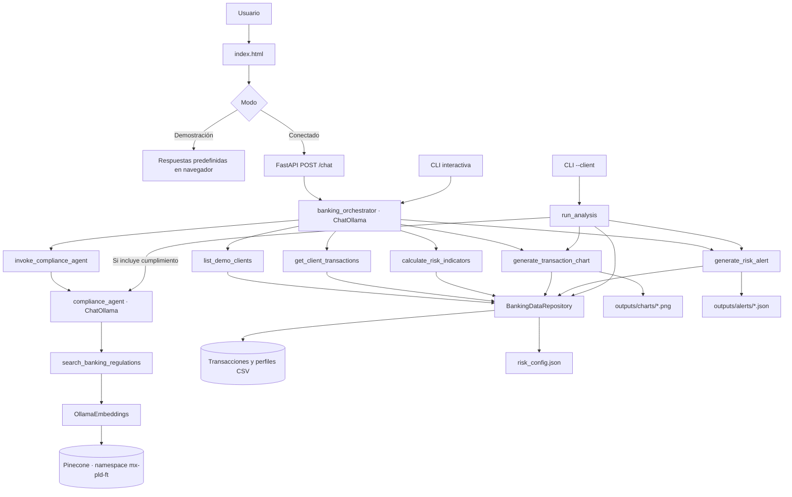

# Arquitectura de BankGuard AI

BankGuard es una beta académica con dos rutas de ejecución: conversación mediante dos agentes y análisis estructurado determinista. La interfaz visual tiene además un modo Demostración que responde desde datos predefinidos del propio HTML.

## Diagrama

## Responsabilidades y contratos

| Componente | Archivo | Responsabilidad |
| --- | --- | --- |
| Frontend | [index.html](../index.html) | Chat, selección de modo y llamadas HTTP. No recibe claves de Pinecone. |
| API | [api.py](../agents/bankguard/api.py) | Valida peticiones, aísla el runtime por solicitud y serializa consultas al modelo local. |
| Orquestación | [orchestrator.py](../agents/bankguard/orchestrator.py) | Coordina herramientas y delega la consulta documental a un agente independiente. |
| Lectura y validación | [transaction_tools.py](../agents/bankguard/transaction_tools.py) | Carga los CSV, valida columnas y valores, y normaliza clientes y periodos. |
| Motor de riesgo | [risk_engine.py](../agents/bankguard/risk_engine.py) | Calcula métricas, atipicidad y score usando reglas del prototipo. |
| Cumplimiento | [compliance.py](../agents/bankguard/compliance.py) | Invoca al especialista y valida que sus afirmaciones tengan evidencia recuperada. |
| Recuperación | [regulatory_search.py](../agents/bankguard/regulatory_search.py) | Consulta Pinecone con namespace y filtro de corpus explícitos, preservando citas y metadatos. |
| Artefactos | [charts.py](../agents/bankguard/charts.py) y [reports.py](../agents/bankguard/reports.py) | Generan PNG y expedientes JSON con rutas y hashes. |
| Esquemas | [schemas.py](../agents/bankguard/schemas.py) | Contratos Pydantic para solicitudes, métricas, factores, evidencia y resultados. |
| Trazas | [tracing.py](../agents/bankguard/tracing.py) | Resúmenes operativos de herramientas y agentes, sin cadena de pensamiento. |

`POST /chat` recibe `message`, `history` y `max_output_tokens`, y responde con `response`, `sources` y `sql` (actualmente `null`). Acepta un mensaje de hasta 500 caracteres, un historial de hasta cuatro mensajes y hasta 300 tokens de salida. Cada solicitud crea un runtime nuevo; un semáforo limita el procesamiento simultáneo a una consulta. `GET /health` informa la configuración sin invocar el modelo ni verificar conexiones externas.

La función Python `run_analysis(...)`, utilizada por la CLI con `--client`, devuelve `AnalysisResult`: métricas, riesgo, evidencia de cumplimiento cuando se solicita, artefactos, trazas, advertencias y errores. Con `--no-compliance` no construye ni invoca el agente de cumplimiento; por eso esa ruta puede demostrar los cálculos sin Ollama ni Pinecone.

## Linaje de datos y reglas

1. [data_generator.py](../agents/bankguard/data_generator.py) genera las operaciones y los perfiles con semilla fija `20261020`.
2. El repositorio de datos valida los CSV antes de analizarlos. Los escenarios escritos en el perfil documentan la demo; no determinan el score.
3. El motor aplica [risk_config.json](../agents/bankguard/risk_config.json). Calcula desviación histórica, frecuencia atípica, concentración e inconsistencia con el perfil; pondera esos factores con `0.40`, `0.25`, `0.20` y `0.15`.
4. Solo produce score concluyente con suficientes operaciones e historial. La ausencia de datos no equivale a riesgo bajo.
5. Las gráficas y expedientes conservan la moneda y las cifras calculadas. Los casos de nivel medio, alto o no concluyente generan expedientes para revisión; un resultado bajo no persiste un archivo de alerta.

La fecha máxima del dataset, `2026-10-31`, es la referencia temporal de la demo. Los archivos generados se escriben en `outputs/` y están excluidos del versionado; se reproducen a partir de los CSV, las reglas y el código de la versión presentada.

## Corpus y recuperación documental

La ingestión está separada en [9_agentic_rag.py](../agents/9_agentic_rag.py): lee los textos de [rag_documents](../agents/rag_documents/), crea documentos y fragmentos, calcula embeddings y escribe en Pinecone. Esta operación puede crear índices y eliminar vectores obsoletos según su configuración; la plantilla raíz [.env.example](../.env.example) establece `DELETE_STALE_VECTORS=false` para evitar esa eliminación. La carga inicial usa un índice propio y puede consumir cuota del proveedor; no se ejecuta automáticamente al iniciar la beta. El comando explícito y los requisitos están en el [README](../README.md).

El runtime de BankGuard solo consulta el índice existente. Debe usar un modelo de embeddings compatible con la ingestión, el namespace `mx-pld-ft` y el filtro `corpus_id=mx-pld-ft`. Conserva fuente, título, autoridad, tipo de documento, página, artículo/disposición, cita y hash cuando existen. Los fragmentos recuperados se tratan como evidencia, sin adoptar instrucciones incluidas en su contenido.

El corpus local incluye LIC, disposiciones del artículo 115 y guías CNBV/GAFI. La clasificación de un documento como ley, disposición o guía permite distinguir su naturaleza; no acredita que una versión histórica esté vigente ni que su interpretación sea suficiente para una decisión legal.

## Alcance de seguridad

Las rutas configurables de datos y salida deben permanecer dentro del repositorio. Las credenciales se cargan desde el entorno o el `.env` local; no forman parte del contrato del navegador. Las trazas externas están deshabilitadas de forma predeterminada.

La API está diseñada para una demo local. No implementa autenticación, permisos de usuarios ni controles de producción para datos bancarios reales. Tampoco envía expedientes a autoridades. Cada resultado de cumplimiento y cada alerta requiere revisión humana.

Regresa a las [instrucciones principales](../README.md) o sigue el [guion de demo](DEMO.md).
